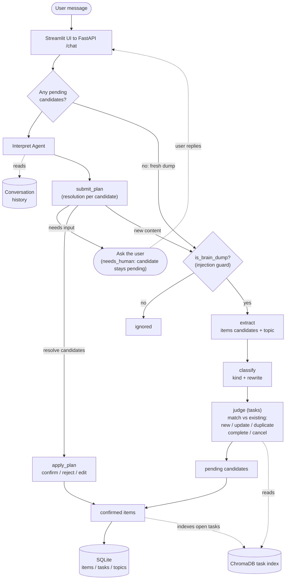

# Brain Dump Organiser

This project is an app where you can write your messy thoughts into a chat box and get them back as organised tasks, notes and ideas, grouped by topic (user-defined). An LLM extracts and classifies the items, checks them against what you already have (duplicates, updates, completions), and asks you to confirm before anything is saved.

## Architecture

A message enters through `/chat`. If there are pending candidates from a
previous turn, it is treated as a reply and handed to the interpret agent;
otherwise it is a fresh dump and goes through extraction and classification.
New content surfaced mid-conversation is sent back through the processing pipeline. When a reply is ambiguous, the agent asks a clarifying question and leaves the item pending until it has a clear answer from the user.




## Features

### User-facing:
- Prompt-injection guard: every incoming message is screened before anything else runs.
- Brain dump to structured items: free text is turned into tasks, notes, and ideas, each assigned a topic.
- Duplicate & update detection: new tasks are checked against what you already have via semantic retrieval (ChromaDB + OpenAI embeddings), so the system can propose an update or completion instead of a duplicate.
- Agentic reply handling: a follow-up message is interpreted against the items still awaiting your decision: it can confirm, reject, edit, re-topic, mark a matched task done/cancelled, or ask a clarifying question when a reply is ambiguous.
- Confirm before saving: nothing is persisted until you confirm (or edit/reject) each proposed item.
- Editable topics: the topic list is user-defined and editable in the UI.

### Extras:
- Per-step model & prompt configuration 
- Eval harness
  
Each step keeps a `design_decisions.md` next to its cases explaining why the
current prompt and model were chosen, with the eval numbers that justify them

- [`evals/01_brain_dump/design_decisions.md`](evals/01_brain_dump/design_decisions.md)
- [`evals/02_extract/design_decisions.md`](evals/02_extract/design_decisions.md)
- [`evals/03_classify/design_decisions.md`](evals/03_classify/design_decisions.md)
- [`evals/04_task_judge/design_decisions.md`](evals/04_task_judge/design_decisions.md)
- [`evals/05_interpret/design_decisions.md`](evals/05_interpret/design_decisions.md)


## Project structure

| Directory   | What's in it                                                            |
|-------------|-------------------------------------------------------------------------|
| `backend/`  | FastAPI app: API routes, services, SQLite repos, LLM calls, versioned prompts |
| `frontend/` | Streamlit UI (brain dump, tasks, notes, ideas pages)                    |
| `evals/`    | Eval runner, test cases, and per-step reports and design decisions      |

## Tech stack

Python · FastAPI · Streamlit · SQLite · ChromaDB · OpenAI API

## Getting started

Prerequisites: [uv](https://docs.astral.sh/uv/) and an OpenAI API key.

1. Clone the repo

```bash
git clone https://github.com/<your-username>/<repo-name>.git
cd <repo-name>
```

2. Install dependencies (creates `.venv` and installs everything)

```bash
uv sync
```

3. Configure: copy the example env file, then set `OPENAI_API_KEY` in `.env`

```bash
cp .env.example .env      # Windows: copy .env.example .env
```

4. Run: the backend and frontend run in two terminals

Terminal 1: API on http://localhost:8000 (docs at /docs)
```bash
uv run uvicorn backend.main:app --reload
```

Terminal 2: UI on http://localhost:8501

```bash
uv run python -m streamlit run frontend/app.py
```

## Evals

The harness scores each step against hand-written cases on accuracy, latency
and cost. Valid `--step` values: `dump`, `extract`, `classify`, `judge`,
`extract_split`, `interpret`, `retrieval`, `judge_rag` (default: all).

Run every step:

```bash
uv run --env-file .env python -m evals.run
```

Run a single step and show failing cases:

```bash
uv run --env-file .env python -m evals.run --step dump -v
```

Run the retrieve-then-judge pipeline and save full results:

```bash
uv run --env-file .env python -m evals.run --step judge_rag --json results.json
```

Pin one model for every step:

```bash
uv run --env-file .env python -m evals.run --model gpt-4o
```

Override a step's prompt at runtime:

```bash
PROMPT_INTERPRET=interpret_v1 uv run --env-file .env python -m evals.run --step interpret
```


## Pipeline steps

Each step is a single LLM call with its own prompt and model, except
`interpret`, which is a bounded tool-calling loop.

| Step        | Input                        | Output                                                            |
|-------------|------------------------------|-------------------------------------------------------------------|
| `dump`      | raw message                  | is this a brain dump? (+ injection guard)                         |
| `extract`   | raw dump + topics            | atomic items, each with a topic                                   |
| `classify`  | extracted items              | a kind per item (task / note / idea) + rewritten text             |
| `judge`     | a task + similar saved tasks | new / update / duplicate / complete / cancel                      |
| `interpret` | reply + pending candidates   | per-candidate action (confirm, reject, change_text, change_kind, change_topic, needs_human) + any new content |

New dumps run `extract` then `classify`; task candidates additionally run
`judge` against similar existing tasks retrieved from ChromaDB.

## Configuration

Everything is configured through environment variables (see `.env.example`).
Only `OPENAI_API_KEY` is required; the rest have sensible defaults.

| Variable                   | Default        | Purpose                                                        |
|----------------------------|----------------|----------------------------------------------------------------|
| `OPENAI_API_KEY`           | none           | Required. Your OpenAI key.                                     |
| `OPENAI_MODEL`             | `gpt-4.1-mini` | Default model for dump / extract / classify / judge.           |
| `MODEL_<STEP>`             | per-step map   | Override a single step's model (e.g. `MODEL_JUDGE=gpt-4.1`). Interpret defaults to `gpt-4.1`. |
| `PROMPT_<STEP>`            | per-step map   | Override a step's prompt file in `backend/prompts/`.           |
| `API_URL`                  | `http://localhost:8000` | Where the Streamlit UI reaches the API.               |
| `SHOW_INTERPRET_TRACE`     | on             | Append the interpret agent's step trace to replies. Set `0` to disable. |
| `LOG_LEVEL`                | `INFO`         | Backend log level; `DEBUG` adds full LLM payloads.             |
| `RETRIEVAL_TOP_K`          | `4`            | Candidates retrieved for the judge.                            |
| `RETRIEVAL_MIN_SIMILARITY` | `0.3`          | Minimum cosine similarity for a retrieved task to count.       |

Model and prompt versions per step live in `backend/llm.py` (`STEP_MODELS`,
`STEP_PROMPTS`); the env vars above override them at runtime.

## Tests

```bash
uv run python -m pytest          # unit + property tests
uv run python -m pytest -q       # quieter
```
